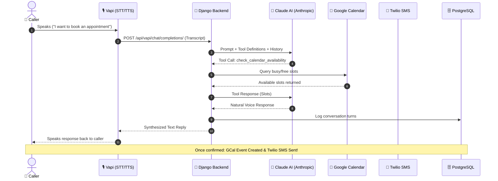

# AI Voice Receptionist & Autonomous Appointment Booking Agent

An enterprise AI-powered phone receptionist that answers calls 24/7, checks real-time availability, books appointments on **Google Calendar**, and sends instant SMS confirmations via **Twilio** — powered by **Django**, **Claude AI (Anthropic)**, **Vapi**, and **PostgreSQL**.

[](https://github.com/codewithmuh/ai-voice-agent/releases)
[](https://github.com/codewithmuh/ai-voice-agent/stargazers)
[](https://github.com/codewithmuh/ai-voice-agent/network/members)
[](LICENSE)
[](https://python.org)
[](https://djangoproject.com)
[](https://anthropic.com)
[](https://youtube.com/@codewithmuh)
[](https://www.linkedin.com/in/muhammadrashid-daha/)


---

## 📑 Table of Contents
- [What It Does](#what-it-does)
- [Architecture & Call Flow](#architecture)
- [Tech Stack](#tech-stack)
- [Quick Start Guide](#quick-start)
  - [1. Clone and Configure](#1-clone-and-configure)
  - [2. Generate Secret Key](#2-generate-a-django-secret-key)
  - [3. Configure Environment Variables](#3-add-your-api-keys-to-env)
  - [4. Google Calendar Setup](#4-google-calendar-setup)
  - [5. Run with Docker Compose](#5-start-with-docker-compose)
  - [6. Expose Local Webhook (ngrok)](#8-expose-with-ngrok)
  - [7. Connect Vapi Voice Pipeline](#9-connect-vapi)
- [Project Layout & Endpoints](#project-structure)
- [Django Admin & Telemetry](#django-admin)
- [Production Deployment](#deploy-to-production)
- [Author & Community](#author)
- [License](#license)

---

## 🌟 What It Does

- 📞 **24/7 Inbound Voice Calls**: Answers phone calls with ultra-low latency, human-like voice synthesis.
- 📅 **Real-Time Calendar Sync**: Dynamically checks Google Calendar for conflict-free availability.
- ⚡ **Autonomous Booking**: Locks in appointments and auto-generates Google Calendar events.
- 📱 **Instant SMS Verification**: Dispatches booking confirmations and reminders via Twilio SMS.
- 📊 **Audit & Call Logs**: Persists full call transcripts, duration, summaries, and patient data into PostgreSQL.

---

## 🏛️ Architecture

Vapi is leveraged as the voice transport layer (Speech-to-Text and Text-to-Speech), while the Django backend acts as the autonomous decision brain driving Claude AI function calling and tool execution.



---

## 🛠️ Tech Stack

| Component | Technology | Purpose |
|---|---|---|
| **Backend Core** | Django 5.0, DRF | Application server, tool orchestration, admin interface |
| **LLM & Reasoning** | Claude API (Anthropic) | Context understanding, conversation flow, agentic tool execution |
| **Voice Transport** | Vapi AI | Telephony integration, real-time STT (Deepgram) & TTS (ElevenLabs/PlayHT) |
| **Database** | PostgreSQL 16 | Relational storage for call logs, appointments, and audit trails |
| **Calendar API** | Google Calendar API v3 | Service-account-driven schedule queries and event creations |
| **Messaging** | Twilio SMS API | Automated booking confirmations sent directly to callers |
| **Containerization** | Docker & Docker Compose | Multi-container local orchestration |

---

## 🚀 Quick Start

### 1. Clone and configure

```bash
git clone https://github.com/codewithmuh/ai-voice-agent.git
cd ai-voice-agent
cp .env.example .env
```

### 2. Generate a Django secret key

```bash
python3 -c "import secrets; print(secrets.token_urlsafe(50))"
```

Paste the output into `.env` as the `SECRET_KEY` value.

### 3. Add your API keys to `.env`

```ini
SECRET_KEY=your-generated-secret-key
DEBUG=True
ALLOWED_HOSTS=localhost,127.0.0.1,0.0.0.0,*

DB_NAME=ai_receptionist
DB_USER=postgres
DB_PASSWORD=postgres
DB_HOST=db
DB_PORT=5432

ANTHROPIC_API_KEY=sk-ant-...
VAPI_API_KEY=...
GOOGLE_CALENDAR_CREDENTIALS=google-calendar-credentials.json
GOOGLE_CALENDAR_ID=your-calendar-id@group.calendar.google.com
TWILIO_ACCOUNT_SID=AC...
TWILIO_AUTH_TOKEN=...
TWILIO_PHONE_NUMBER=+1...
```

**Where to get keys:**
- **Anthropic:** [console.anthropic.com](https://console.anthropic.com)
- **Vapi:** [dashboard.vapi.ai](https://dashboard.vapi.ai)
- **Twilio:** [twilio.com/console](https://www.twilio.com/console)
- **Google Calendar:** Follow setup below

---

### 4. Google Calendar setup

#### Step 1: Create a Google Cloud project
1. Go to [Google Cloud Console](https://console.cloud.google.com).
2. Click **Select a Project** → **New Project** → Name it → **Create**.

#### Step 2: Enable the Calendar API
1. Go to **APIs & Services** → **Library**.
2. Search for **"Google Calendar API"** → Click **Enable**.

#### Step 3: Create Service Account Credentials
1. Go to **APIs & Services** → **Credentials**.
2. Click **+ Create Credentials** → **Service Account**.
3. Name it (e.g. `calendar-bot`) → **Create and Continue** → **Done**.
4. Click the newly created service account → **Keys** tab → **Add Key** → **Create New Key** → **JSON**.
5. Save the file in the project root as `google-calendar-credentials.json`.

#### Step 4: Share Calendar with Service Account
1. Copy the `client_email` from `google-calendar-credentials.json` (e.g. `calendar-bot@project.iam.gserviceaccount.com`).
2. In [Google Calendar](https://calendar.google.com), click your calendar settings → **Share with specific people or groups**.
3. Add the service account email and give permission: **Make changes to events**.

---

### 5. Start with Docker Compose

```bash
docker compose up --build
```

Django will start at `http://localhost:8000` with PostgreSQL connected.

### 6. Create Superuser for Admin Dashboard

```bash
docker compose exec web python manage.py createsuperuser
```

### 7. Expose with ngrok

```bash
ngrok http 8000
```

Copy the forwarding HTTPS URL (`https://xxxx.ngrok-free.app`).

### 8. Connect Vapi

1. Go to [Vapi Dashboard](https://dashboard.vapi.ai).
2. Create an Assistant → Set **Model** to **Custom LLM**:
   ```
   https://xxxx.ngrok-free.app/api/vapi/chat/completions/
   ```
3. Set **Server URL** (for post-call summary webhooks):
   ```
   https://xxxx.ngrok-free.app/api/vapi/webhook/
   ```
4. Assign a phone number and dial to test!

---

## 📂 Project Structure

```
ai-voice-agent/
├── receptionist_project/
│   ├── settings.py              # Django config
│   └── urls.py                  # Root URL routing
├── calls/
│   ├── models.py                # CallLog & Appointment schema
│   ├── views.py                 # Custom LLM & Vapi webhook endpoints
│   ├── urls.py                  # API route definitions
│   ├── admin.py                 # Django admin registration
│   ├── agent/
│   │   ├── receptionist.py      # Claude agentic loop orchestrator
│   │   ├── tools.py             # Tool schemas (Calendar, SMS, DB)
│   │   └── prompts.py           # Domain system prompt
│   └── services/
│       ├── calendar.py          # Google Calendar API integration
│       ├── sms.py               # Twilio SMS client
│       └── database.py          # Database operations
├── docker-compose.yml
├── Dockerfile
├── .env.example
└── requirements.txt
```

### Key API Endpoints

| Endpoint | Method | Description |
|---|---|---|
| `/api/vapi/chat/completions/` | `POST` | Custom LLM bridge connecting Vapi voice requests to Claude |
| `/api/vapi/webhook/` | `POST` | Receives end-of-call telemetry, saving summaries to DB |
| `/api/vapi/webhook/` | `GET` | Health check endpoint |

---

## 🖥️ Django Admin Dashboard

Access the admin dashboard at `http://localhost:8000/admin/`:
- **Call Records**: Full transcripts, duration, caller phone numbers, and LLM sentiment.
- **Appointments**: View, modify, or cancel bookings synced with Google Calendar.
- **Filters**: Quickly filter calls and appointments by date, status, and patient name.

---

## 🚢 Deploy to Production

Deploy easily on platforms like Railway, AWS EC2, or Render:

```bash
# Example with Railway CLI
railway init
railway add --plugin postgresql
railway up
```

Set environment variables in your cloud provider's dashboard and update the Vapi webhook URLs accordingly.

---

## 👨‍💻 Author

**Muhammad Rashid** — AI & DevOps Engineer, AWS Community Builder.  
- 🎥 **YouTube:** [@codewithmuh](https://youtube.com/@codewithmuh)  
- 💼 **LinkedIn:** [Muhammad Rashid](https://www.linkedin.com/in/muhammadrashid-daha/)  
- 🌐 **Website:** [codewithmuh.com](https://codewithmuh.com) · [devopsbymuh.com](https://devopsbymuh.com)

⭐ **If you find this AI Voice Agent helpful, please give it a star!**

---

## 📄 License

This project is licensed under the [MIT License](LICENSE).
